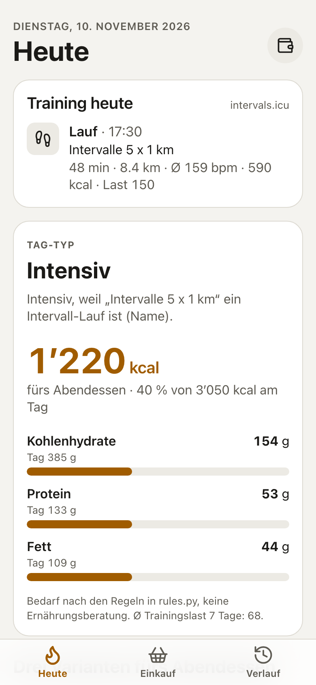
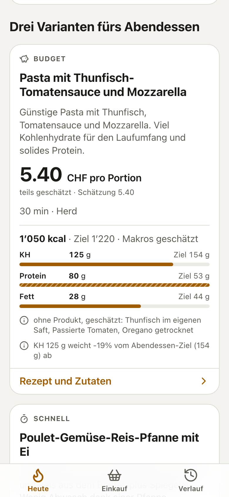
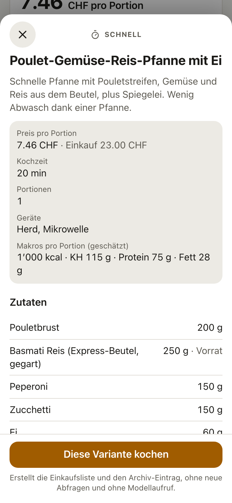
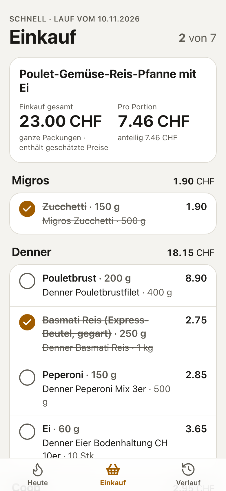
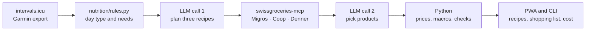
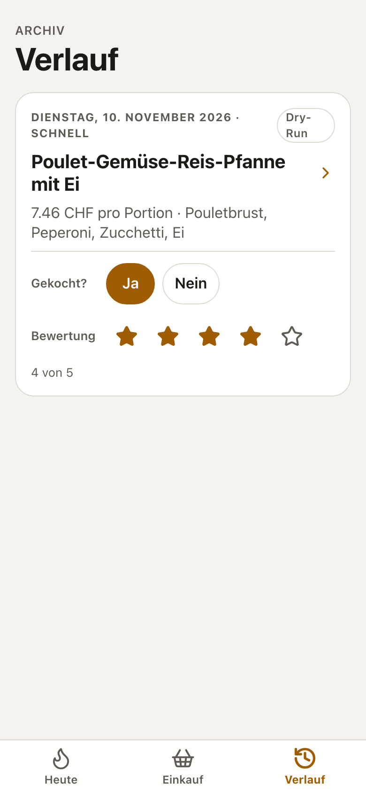

<h1> FuelPlan CH</h1>

Meal suggestions based on the training I actually did – with real products and prices from Migros, Coop and Denner.

<table>
  <tr>
    <td></td>
    <td></td>
    <td></td>
    <td></td>
  </tr>
  <tr>
    <td align="center">Today's training and what dinner needs</td>
    <td align="center">Three variants, priced</td>
    <td align="center">Recipe</td>
    <td align="center">Shopping list per store</td>
  </tr>
</table>

Screenshots show the demo mode: an invented training week, mock prices and stored model answers. The interface is in German.

## About this project

I built this for myself, not as a product for others. I use it every day to match what I eat to my training (marathon preparation plus strength work) and to shop cheaply. That is why it is tailored to my situation: Swiss supermarkets, my kitchen, my budget.

## How it works

1. **Training.** The app reads today's activities and the last seven days from intervals.icu (fed by my Garmin watch).
2. **Day type and needs.** Plain Python classifies the day (rest, easy run, long run, strength, intensive, …) and works out calories, carbs, protein and fat for the day and for dinner. All numbers live in one file, `fuelplan/nutrition/rules.py`.
3. **Three recipes.** One model call proposes three dinners that fit the dinner target: budget, quick and elaborate.
4. **Cheapest products per chain.** The ingredients of all three recipes are looked up at Migros, Coop and Denner. A second model call picks a product for each ingredient, only from the products that were actually returned.
5. **Shopping list and cost.** Python recomputes the real price per portion and the macros, checks them against budget and target, and builds a shopping list grouped by store.



The model never does arithmetic. It writes recipes and chooses products; day type, needs, prices, sums and macros are computed and checked in Python. A full run is exactly two model calls. More detail is in [docs/ARCHITECTURE.md](docs/ARCHITECTURE.md).

## Features

- Day analysis from real training data, with a one-sentence reason for the day type
- Three dinner variants per day (budget, quick, elaborate), each with real price per portion and macros shown against the dinner target
- Product search across Migros, Coop and Denner; promotions are marked, estimated prices are labelled as estimates
- Shopping list grouped by store that works offline in the shop and syncs check marks later
- Recipe archive with "cooked" and a rating; recipes from the last 14 days are not suggested again
- Cost view: tokens and cost per run against a monthly API budget
- Live progress while a run is working (server-sent events that resume after a dropped connection)
- Installable PWA with light and dark mode, plus a CLI for the same pipeline
- Mock and dry-run modes, so development and tests need no network and cost nothing



## Tech stack

- **Backend:** Python 3.13, FastAPI, pydantic, httpx, uvicorn
- **Frontend:** React 19, Vite, TypeScript, own CSS with design tokens; PWA with a service worker for the app shell
- **Model:** Claude through OpenRouter, using the Anthropic SDK with structured JSON output
- **Supermarket data:** [swissgroceries-mcp](https://www.npmjs.com/package/@nicktcode/swissgroceries-mcp), called from Python as an MCP client
- **Tests:** pytest, vitest, Playwright for screenshots

## Running it yourself

The app is built for my own use, so expect rough edges if your setup differs. The demo mode needs no API keys and no training data.

```bash
python3 -m venv .venv
.venv/bin/python -m pip install -r requirements.txt
npm --prefix web ci
npm --prefix web run build
.venv/bin/python -m fuelplan demo
```

Then open http://127.0.0.1:8000. The demo uses an invented training week, mock supermarket prices and stored model answers, and writes its runs to a temporary folder.

To use it with your own data:

1. Copy `.env.example` to `.env` and fill in your intervals.icu API key and athlete ID and an OpenRouter key. Body weight and postcode go there too.
2. Copy `profile.example.md` to `profile.md` and describe yourself: goals, kitchen, cooking time, budget, dislikes. `profile.md` takes precedence as soon as it exists and becomes part of the system prompt.
3. Start the server with `.venv/bin/python -m fuelplan serve`. Add `--mock` for mock prices or `--dry-run` for stored model answers.

The same pipeline runs from the command line:

```bash
.venv/bin/python -m fuelplan day            # day analysis, no model call
.venv/bin/python -m fuelplan today          # day analysis and three priced variants
.venv/bin/python -m fuelplan shop budget    # shopping list for the chosen variant
.venv/bin/python -m fuelplan usage          # API cost this month against the budget
```

Some things are specific to me and live in the code: the day-type rules in `fuelplan/nutrition/rules.py` are my own starting assumptions, and `fuelplan/config.py` has a cut-off date before which training comes from a Garmin CSV export instead of intervals.icu.

## Tests

```bash
.venv/bin/python -m pytest      # backend: rules, pipeline, API, with mock data only
npm --prefix web test           # frontend: offline storage, SSE resume, formats, contrast
```

Neither suite needs a `.env`, a `profile.md` or a network connection.

## Privacy and security

- The backend binds to `127.0.0.1` only. I reach it from my phone through my private VPN; it is not exposed to the internet.
- There are no keys in this repository. Keys are read from `.env`, which is git-ignored.
- My profile, training data, runs and recipe archive are not part of this repository. The profile, the test fixtures and the screenshots here use invented data.
- intervals.icu is accessed read-only (GET requests only).

## Status

In active development and in daily use. The nutrition rules are rough starting values that I adjust as I go. This is not nutrition advice.

## License

[MIT](LICENSE)
