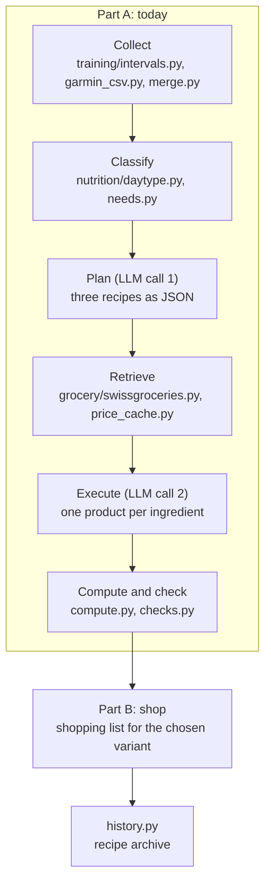

# Architecture

FuelPlan CH is a Python package (`fuelplan/`) with two thin front ends: a command line and a FastAPI layer that serves a React PWA. All logic lives in the package. The API only passes data through, and the web app only displays it.

## Pipeline

A run has two parts. Part A does all the work; part B only filters.



| Step | What happens | Where |
|---|---|---|
| Collect | Today's activities plus the seven days before, from intervals.icu (GET only) or a Garmin CSV export for older days. Only day summaries leave this step, never raw files. | `fuelplan/training/` |
| Classify | Day type from the activities (interval run, race, run by distance, strength, combinations, rest day), then calories and macros for the day. Dinner gets 40 % of the day. | `fuelplan/nutrition/` |
| Plan | First model call. Input: day analysis, dinner target, profile, recipes of the last 14 days. Output: three recipes (budget, quick, elaborate) validated against a pydantic schema. | `fuelplan/llm/` |
| Retrieve | Each search term is queried once across Migros, Denner and Coop. Base ingredients (rice, pasta, oil, …) come from a price cache. The number of queries per run is capped. | `fuelplan/grocery/` |
| Execute | Second model call, one for all three variants. The model may only choose product IDs that were returned by Retrieve, or say that nothing fits. | `fuelplan/llm/` |
| Compute and check | Python computes the real price per portion, the shopping total and the macros, then checks budget, macros (±15 %) and completeness. Violations become warnings in the output. | `fuelplan/compute.py`, `fuelplan/checks.py` |
| Shop | Reads the stored result of part A, filters to the chosen variant, renders the shopping list and writes the archive entry. No supermarket query, no model call. | `fuelplan/pipeline.py` |

## Design decisions

- **Python does the arithmetic.** The model writes recipes and picks products. Day type, needs, prices, sums and macros are computed in code, so the numbers are reproducible and testable.
- **One source for the nutrition numbers.** Every threshold and every gram-per-kilogram value is in `fuelplan/nutrition/rules.py`. Each classification comes with a one-sentence reason.
- **Two model calls per run.** Both are in part A. Token counts and cost are logged per call and summed against a monthly budget.
- **Every run is a folder.** `runs/<date>_<time>/` holds the day context, both requests and responses, the retrieved products and the rendered output. The API and part B read the same files, so a run survives a server restart.
- **Failing sources are named, not hidden.** If the supermarket lookup fails, the run continues with prices marked as estimates. Without training data there is no day analysis and the run stops with a clear message.
- **Mock and dry-run.** `--mock` replaces the supermarket bridge with fixture products, `--dry-run` replaces the model with stored answers. Tests and the demo mode use both.

## API and web app

`fuelplan/api/` exposes the pipeline to the PWA in `web/`.

- A run is a background job: `POST /api/runs` returns a run ID, progress arrives as server-sent events under `/api/runs/{id}/events`, and the stream resumes from `Last-Event-ID` after a dropped connection. Only one run works at a time.
- The app never sends a date; the server always uses today in Europe/Zurich.
- The shopping list is stored on the device. Check marks made offline carry a timestamp and are merged by the server later (`fuelplan/checklist.py`).
- Errors always have the shape `{"error": {"code", "message"}}`, without stack traces, keys or paths.
- The server binds to `127.0.0.1` and serves the built frontend from `web/dist`, so there is one port and no CORS.

## Layout

```
fuelplan/
  __main__.py        CLI: day, today, shop, usage, serve, demo
  config.py          paths, limits, model IDs, .env loading
  models.py          data classes (Activity, DayContext, Needs, …)
  training/          intervals.icu client, Garmin CSV reader, merge
  nutrition/         rules.py (the numbers), daytype.py, needs.py
  grocery/           bridge interface, swissgroceries MCP client, mock, price cache
  llm/               client, prompts, schemas, dry-run
  pipeline.py        the run in two parts
  compute.py         prices, packs, macros
  checks.py          budget, macro and completeness checks
  api/               FastAPI app, background job with SSE, response models
  demo.py            demo mode with an invented training week
web/                 React + Vite + TypeScript PWA
tests/               pytest suites and fixtures (invented data)
```
